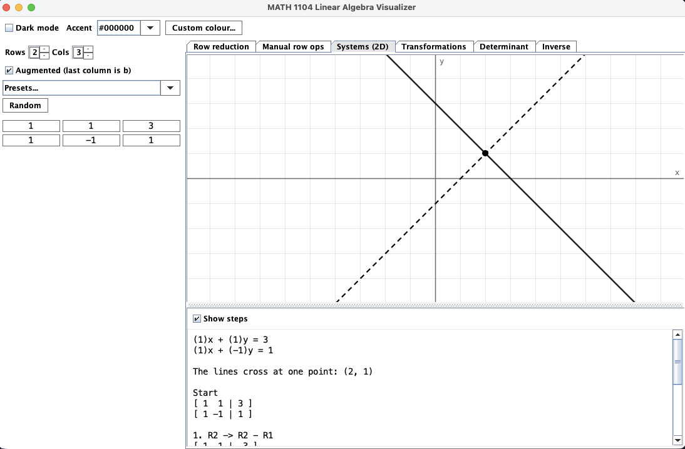

# MATH 1104 Linear Algebra Visualizer

A small Java Swing app for working through MATH 1104 problems. Type in a matrix and
see the picture and the steps. Arithmetic uses exact fractions, so the row operations
match what you'd write by hand.

## Run

Needs JDK 26.

    ./gradlew run
    ./gradlew test

## What's in it

- **Row reduction**: REF and RREF with a numbered log of every operation, pivots, free
  variables, and the parametric solution.
- **Manual row ops**: apply swaps, scaling and row additions yourself.
- **Systems (2D)**: 2x2 systems drawn as lines (one point, parallel, or the same line).
- **Transformations**: unit square and grid before/after a 2x2 matrix. Drag the tips of
  Ae1 and Ae2 to edit the matrix.
- **Determinant**: cofactor expansion, area/volume scaling, and a few property checks.
- **Inverse**: inverse via [A | I] plus an Invertible Matrix Theorem checklist.

The matrix on the left is shared by every tab. Presets and a random button are
there for quick examples. Dark mode and the accent colour are in the top bar.

## GUI
